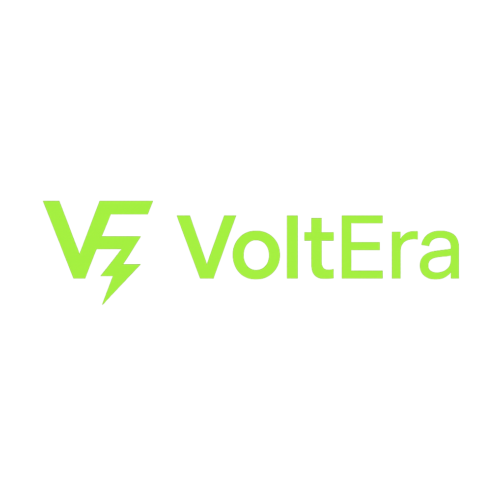
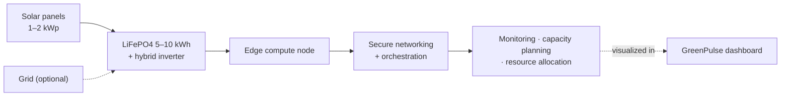
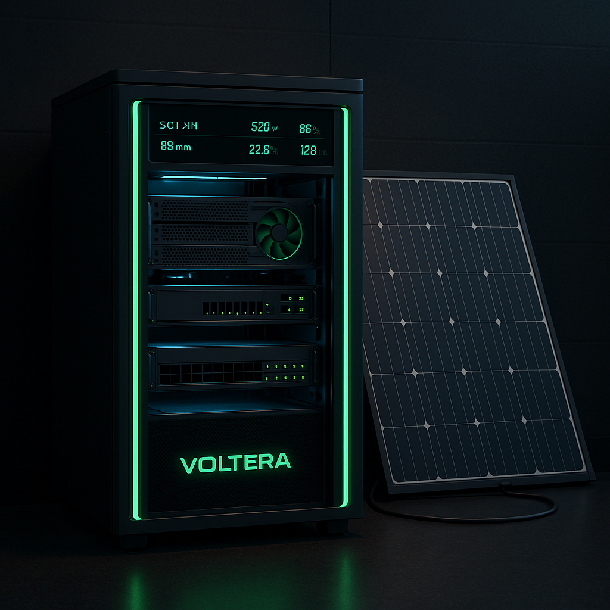
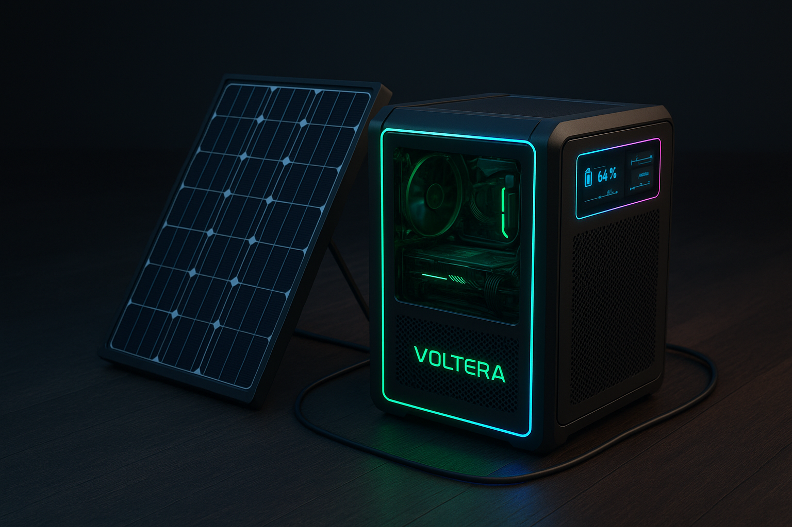
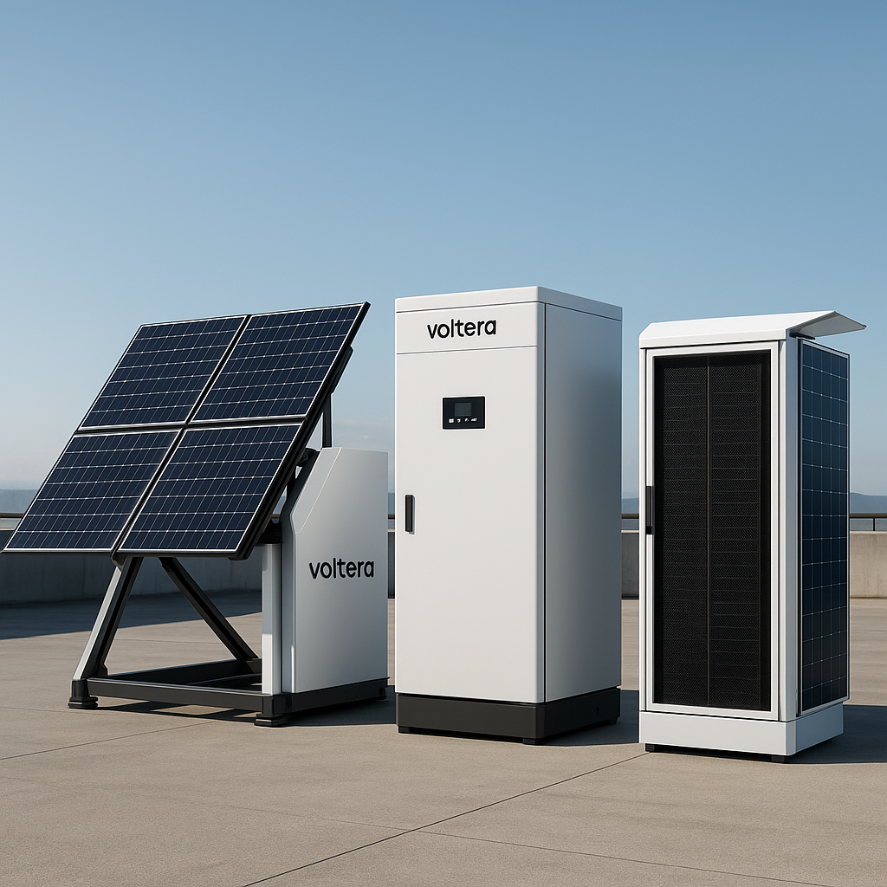
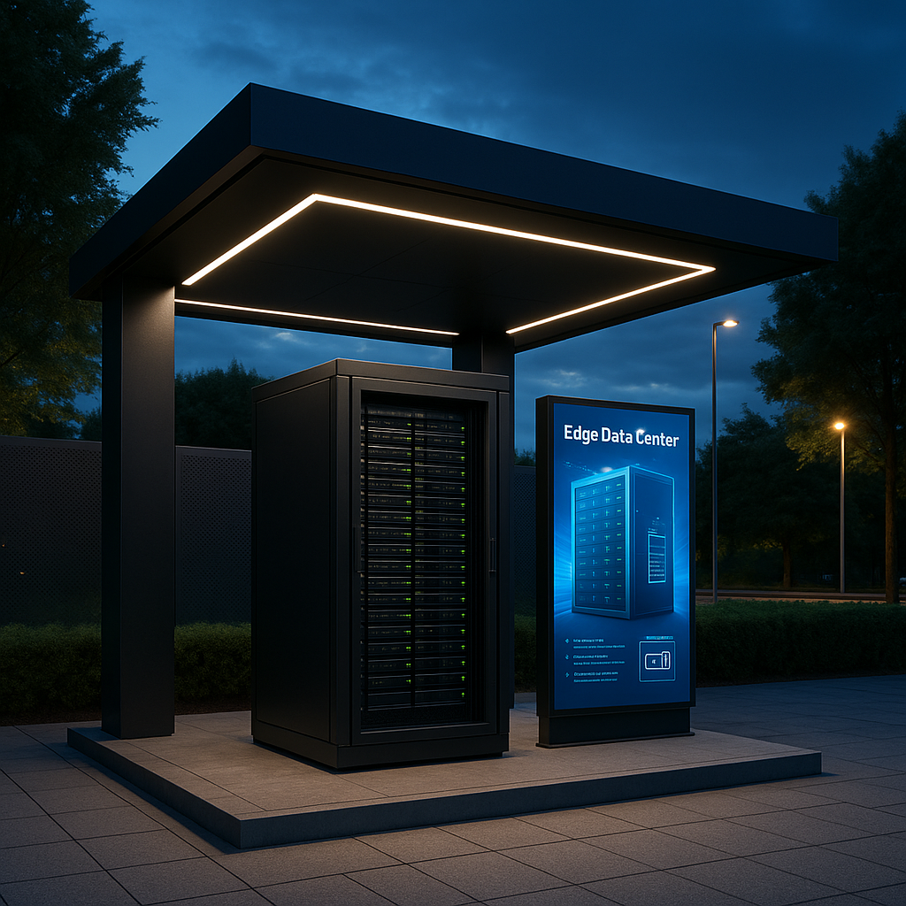
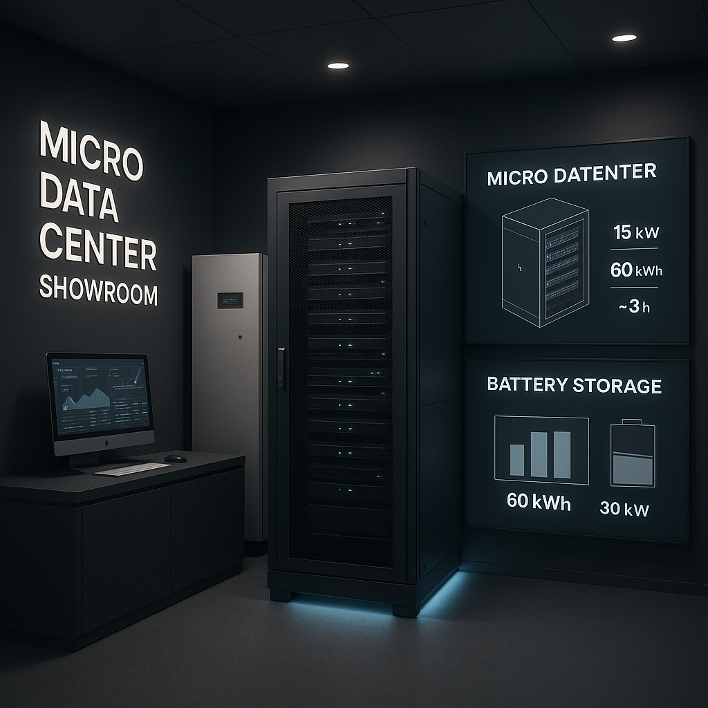
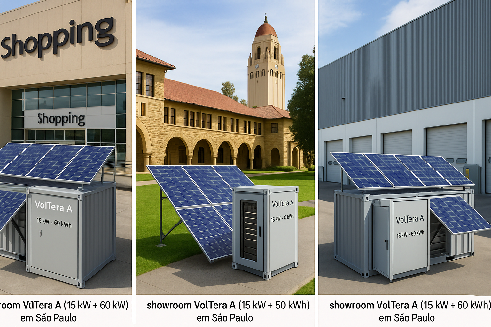

# VoltEra

### Renewable-powered edge computing, from idea to feasibility

The product, architecture and feasibility dossier for modular nodes that combine solar generation,
LiFePO4 storage and edge-compute capacity — sized for creators, e-sports and small operators in Brazil.

---

## Table of Contents

- [Overview](#overview)
- [System concept](#system-concept)
- [Repository map](#repository-map)
- [Concept art](#concept-art)
- [Responsible use](#responsible-use)
- [Current status](#current-status)

---

## Overview

**VoltEra** asks a simple question: *could a creator or a small team run its own always-on compute, powered by
the sun, instead of renting it from a hyperscaler?* This repository is the planning work behind
that question — what to build, what it costs, what can go wrong and what the law says.

It is built for:

- founders and investors evaluating renewable edge infrastructure;
- engineers who want a starting PRD, BOM and risk register to challenge;
- anyone studying how energy, storage and compute fit in one cabinet.

  

---

## System concept

---

## Repository map

| Document | What it covers |
|---|---|
| [Executive Summary](VolTera_Executive_Summary.md) | Mission, market, business model |
| [PRD and Architecture](VolTera_PRD_and_Architecture.md) | Requirements and proposed system design |
| [Operations Manual](VolTera_Operations_Manual.md) | Operating assumptions and procedures |
| [Compliance and Regulation](VolTera_Compliance_and_Regulation.md) | Initial Brazilian regulatory research |
| [Risk and Mitigation](VolTera_Risk_and_Mitigation.md) | Technical and operational risks |
| [Startup Guide](VolTera_Startup_Guide.md) | Steps to take the concept to a company |
| `VolTera_BOM.xlsx` | Preliminary bill of materials |
| `VolTera_Financial_Model.xlsx` | Scenario-based financial model |
| `VolTera_Compliance_Register.xlsx` · `VolTera_Risk_Register.xlsx` | Structured trackers |
| `VolTera_Roadmap.csv` | Month-by-month delivery plan |

The documents are written in Portuguese.

---

## Concept art

  
  
  

  
  
  

AI-generated concept renders, not photos of built hardware.

---

## Responsible use

Electrical systems, batteries, renewable generation and datacenter equipment carry safety and regulatory risk.
Nothing here replaces licensed electrical, structural, environmental, legal or financial professionals.
Hardware specs, financial projections and regulatory assumptions need specialist validation before any purchase.

Related: [GreenPulse](https://github.com/Samurai33/GreenPulse) (dashboard prototype) ·
[VoltEra Nexus](https://github.com/Samurai33/VoltEra-Nexus-The-Energy-Consciousness-Protocol) (digital-art companion).

---

## Current status

| | |
|---|---|
| **Concept & architecture** | Documented |
| **Dashboard** | Public demo |
| **Hardware** | Not built; renders only |
| **Regulatory & ROI** | Pending qualified review; numbers are illustrative |

---

**Need something built, secured or kept online?** → [samurai@n3xus.dev](mailto:samurai@n3xus.dev) · [n3xus.dev](https://n3xus.dev)

© Thiago "Samurai" Rangel · [N3XUS](https://n3xus.dev)

